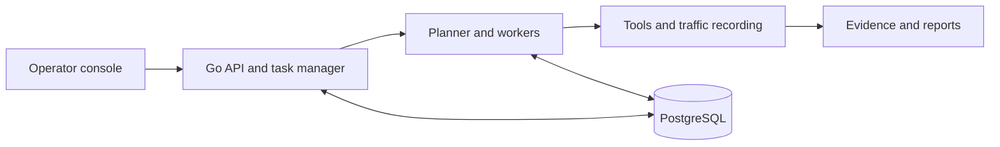
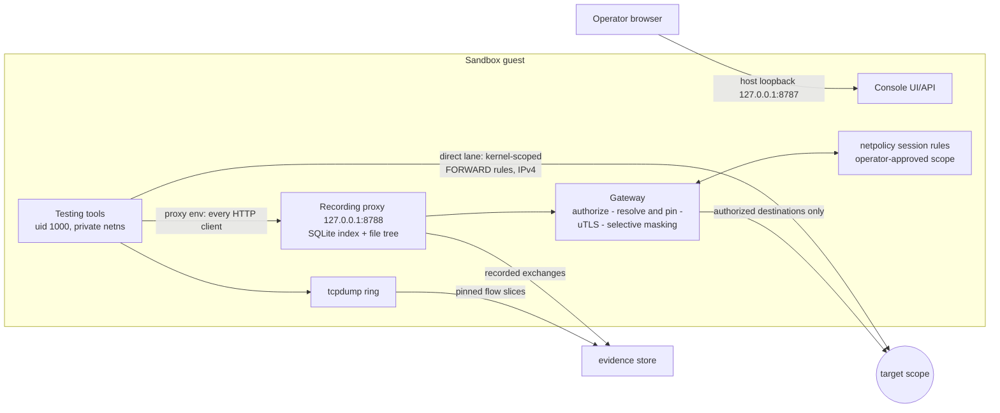

# m1nervac0nsole

**An operator-controlled console for LLM-driven security testing.**

m1nervac0nsole brings planning, tool execution, evidence, traffic and reusable knowledge into one self-hosted workspace. AgentLab is the surrounding research environment: an optional isolated VM, capture pipeline and export tooling for studying real agent runs.

A Go backend, a statically embedded Next.js interface and PostgreSQL as the system of record.

[Application guide](m1nervac0nsole/README.md) · [Changelog](m1nervac0nsole/CHANGELOG.en.md) · [Contributing](m1nervac0nsole/CONTRIBUTING.en.md) · [Security](m1nervac0nsole/SECURITY.en.md) · [License](m1nervac0nsole/LICENSE)

> **Authorized use only.** Run engagements only against systems you own or have explicit permission to test. Agents execute real tools and can change target systems. Review scope, approvals, provider configuration and data handling before starting a task.

## Current status

**Active development; self-hosted research software.** m1nervac0nsole is based on [ARTEX](https://github.com/structuredstanza/ARTEX), the autonomous penetration-testing console, and extends it with a recursive self-improvement (RSI) loop, a hardened network boundary and the research environment described below. The current development build includes the m1nervac0nsole rebrand and the knowledge/curator workspace. It has been built and exercised locally; this is not a claim of production readiness, independent security certification or autonomous testing accuracy.

The application can run without the AgentLab VM. The VM/capture layer is a separate, deployment-specific environment, not a turnkey installer for a fresh checkout. Model access, credentials and runtime state must be provisioned separately.

### Available today

| Area | Capabilities |
| --- | --- |
| Engagements | Planner/worker orchestration, task scope, goals, findings, pause/resume and operator handoff when blocked |
| Operator control | Tool interception, allow/deny/ask rules, approval history and human-in-the-loop conversations |
| Evidence | Asset and exploration graphs, findings, task reports, tool output, HTTP traffic and LLM records |
| Memory | Knowledge and reflection management, search, editing, promotion/demotion, graduation and prompt-injection preview |
| Curator | A persistent chat workspace for reading sources and proposing task-private knowledge; every write proposal requires approval |
| Providers | Configurable model profiles, OpenAI-compatible transports and optional native provider-proxy integrations |
| Research lab | Optional microsandbox VM, VPN-backed runs, packet/process/resource capture and reviewable training exports |

Existing m1nervac0nsole module paths, environment variables, binary/database names, the `m1nervac0nsole_token` cookie and forensic markers remain compatibility contracts; the rebrand does not migrate those identifiers. The single operator account is `minerva`.

## A look inside


The overview brings task state, findings, assets, traffic and model usage together. The same navigation leads to task workspaces, evidence browsers, configuration and memory curation.

<details>
<summary>Findings and conversations</summary>


</details>

Screenshots show the current interface using existing local demo fixtures, not a live engagement. Displayed targets and credentials are fictional.

## How it fits together



The browser is a static application embedded into the Go binary. PostgreSQL owns task, graph, finding and memory state; HTTP capture uses a separate file tree and SQLite index. Provider recording and evidence retention are separate from disposable traffic capture.

Recorded HTTP follows the session recorder → gateway path: Chrome uTLS and selective tool-default User-Agent masking, with `navigation` headers for Stealth and `ua` masking for Careful/Standard/Unbound. Profiles are guidance, not request-rate ceilings; tool-run concurrency defaults to 16 globally and per target. Enrichment uses recorded gateway sessions with navigation masking.

All testing subprocesses, including SDK/Bash, scripts and manifests, use the backend-wrapped execbox client. With live `tun0` and no operator global proxy, they can receive a scoped IPv4 direct lane; research/install stay relay-only. Interactive HTTP keeps recorder proxy settings. Standard/Unbound bulk-HTTP manifests declaring `RateRPS` omit proxy environment and argv only after a lane snapshot is available, and refuse execution if it disappears. Raw tools can use the lane regardless of HTTP proxy settings.

Root-namespace FORWARD rules enforce authorized scope and exclusions in both directions, including established flows. They deny infrastructure (loopback, `10.98.0.0/16`, link-local, guest-local addresses, `host.microsandbox.internal` and configured native-provider/profile endpoints), not entire VPN destination ranges. DNS A grants are filtered, TTL-expiring and re-evaluated on policy updates; the session link has no IPv6. Policy refresh polls every second with a combined one-second read/apply deadline: revocation normally takes at most about two seconds plus kernel teardown/scheduling. Failures cancel processes rather than retain an old policy; supervisor apply failures kill sessions.

Direct traffic has no gateway masking or HTTP recording. Preserve execution artifacts and pinned packet captures, and replay safe HTTP through the recorder for inspectable evidence. See the [network reference](m1nervac0nsole/docs/design/network-layer.md). These source behavior descriptions are not deployment or test claims.

### Repository layout

| Path | Purpose |
| --- | --- |
| [`m1nervac0nsole/`](m1nervac0nsole/) | Console application, backend, frontend, agent tools and application documentation |
| [`lab`](lab) | Host CLI for the optional research VM |
| [`deployment/`](deployment/) | Guest image, supervision, provider-proxy integration, capture and export tooling |
| [`tests/`](tests/) | Cross-layer test runners and Python suites |
| [`.github/workflows/`](.github/workflows/) | CI workflows |

## Relationship to upstream ARTEX

m1nervac0nsole is a rebrand and extension of [ARTEX](https://github.com/structuredstanza/ARTEX), the autonomous penetration-testing console, under AGPL-3.0. The planner/worker orchestration, dual asset/exploration graphs, findings, traffic recording, interception approvals and human-in-the-loop chat come from ARTEX and keep their upstream shape. The deviations below are what this tree adds or replaces.

| Deviation | What this tree does beyond ARTEX |
| --- | --- |
| RSI memory loop | ARTEX ships the RSI contract and shadow lessons; this tree adds the working memory layer: a knowledge base plus a per-task reflection pool, write-time credential scrubbing, task-private candidates, an owner-only promotion path and a propose-only curator, with usage telemetry. See [RSI.md](m1nervac0nsole/RSI.md). |
| One outbound boundary | Recorded tool traffic leaves through a recording proxy whose origin side is a gateway: backend-issued session credentials, destination authorization against task scope, uTLS Chrome handshakes and selective tool-default identity masking; non-proxied tools take the kernel-scoped direct lane instead. ARTEX records traffic but has no authorization transport. |
| Subprocess isolation | Every testing subprocess runs unprivileged in its own network namespace via `execbox`, admitted only to the gateway and the resolver, with kernel-enforced scope on the direct lane. ARTEX runs tools in the host process. |
| Evidence pinning | Findings bind recorded exchanges, execution artifacts and content-addressed pcap flow slices pinned from the guest capture ring, so non-HTTP work keeps inspectable proof. |
| Browser roles | Two browsers an agent cannot promote between: a research reader that refuses engagement targets, and a task-scoped Chromium under the same gateway boundary. |
| Research environment | The repository root adds the `lab`/`deployment` layer: a microsandbox VM, VPN-backed runs with kill switches, packet/process/resource capture and reviewable training exports. |
| Owned source trees | The vendored Norma SDK and a patched go-mitmproxy live in `third_party/` and travel with this tree; ARTEX consumes them as plain dependencies. |
| English-only discipline | One message catalog and an ASCII-only source gate for every string that must match non-English input. |

### Ingress and egress flow

In the lab deployment the console, its recording proxy and the gateway all run inside the guest; the operator reaches the UI/API through a host loopback port map. Recorded traffic (HTTP/HTTPS tools, the testing browser, enrichment probes) enters the guest-local recording proxy and leaves only through the gateway; direct-lane traffic (nmap, SSH, UDP scanners and other non-proxied tools) is admitted by kernel rules scoped to the task's authorized addresses and is captured as packets instead of exchanges:



The host also runs a native provider proxy on its own :8788 for LLM provider traffic; it is a separate service from the guest-local recorder, not part of the tool path. Enrichment probes use recorded gateway sessions like any other client, so the direct lane is the only traffic without an HTTP record, and its evidence is the capture ring. The packet-level detail is in the [network reference](m1nervac0nsole/docs/design/network-layer.md).

## Getting started

### Run the application

Start with the [application guide](m1nervac0nsole/README.md) for configuration, source builds and local development. The source toolchain is Go **1.26.3**, Node.js **22** and PostgreSQL **16**; npm dependencies require Node.js **22.22.2 or newer**.

- Go and frontend commands run inside `m1nervac0nsole/`, not the repository root.
- A deployable binary must include the static frontend and the `embedui` build tag. A plain `go build` does not ship the console UI.
- Configure a reachable PostgreSQL database and a model provider. No usable provider credentials or private runtime state are supplied by this repository.
- Keep the application on a trusted network or loopback interface. Do not expose an unaudited deployment directly to the public Internet.

### Use the optional research lab

The lab requires a Linux host with KVM, a provisioned microsandbox runtime and an imported guest image. Docker is used to build that image; the workload itself runs in a VM, not an ordinary Docker container. The Python dependency is pinned in [`deployment/requirements.txt`](deployment/requirements.txt).

Review [`deployment/sandbox.yaml`](deployment/sandbox.yaml), [`deployment/Dockerfile`](deployment/Dockerfile) and the host/provider settings before provisioning. The sandbox pins `agentlab/m1nervac0nsole:deepseek-v1` with `pull_policy: never`, so build or import an image under exactly that tag first — `lab` does not pull one. Image names, mounts and host services must match your environment. Existing state must not be shared by two running VMs.

After provisioning, run these commands from the repository root:

```sh
./lab build                         # Build the embedded UI, binary, skills and guest scripts
./lab image-build                   # Build and capability-check the configured image as a candidate
./lab start                         # Start the VM and capture services
./lab start --vpn /path/to/lab.ovpn  # ...or start through an OpenVPN profile (one start, not both)
./lab status
./lab exec -- python3 -c 'print("guest execution")'
./lab export                        # Export recorded data for private review
./lab prune <export-id>             # Delete only what a verified export contains
./lab stop                          # Graceful shutdown and capture finalization
```

`lab start` refreshes the host-built application through a read-only `/dist` mount. Change source and rebuild/restart; do not manually replace guest binaries. Use `./lab --help` for the command interface. A lab-provisioned UI is published on `http://127.0.0.1:8787`; credentials are local deployment state, not a public default login.

To check a running lab end to end, run `python3 deployment/verify_capture.py` (needs host `tshark`; it drives the authenticated custom-tool test endpoint, so it needs no credential) and `python3 deployment/verify_completeness.py` (nonces through HTTP, SSE, a large body and a WebSocket, plus a keylog fixture; it runs its own isolated gateway and recorder, so it needs no credential and changes no policy). Both are manual and read-only.

## Capture, privacy and limitations

The optional lab records configured model requests/responses, tool activity, inspectable HTTP traffic, raw packets, process/syscall traces and resource samples. Exports include per-table database dumps, application artifacts and a curated conversation format for downstream analysis.

Important boundaries:

- **Raw captures and exports are sensitive.** Prompts, credentials, target data, OAuth callback material and provider capabilities can appear in recordings, and an export is credential-bearing by design so it stays faithful to the database it captured. Keep runtime state and raw exports private, and redact before sharing.
- **Redaction is heuristic.** Training exports are not guaranteed free of secrets or personal data. Review and minimize them before sharing or training.
- **Only exposed reasoning is available.** Provider summaries and opaque replay state are not hidden chain-of-thought. Encrypted TLS in a packet capture is decryptable only with the keylog the capture session writes beside it, and that keylog travels with the export.
- **Capture is not tamper-proof.** Online file/packet copies are not atomic machine checkpoints; guest root can affect guest-side recordings. Export hashes detect later changes, not the authenticity of the original run.
- **Masking is not anonymity.** Providers still see their own account/client identities and submitted content. Proxy behavior, scope checks and approval rules do not replace authorization or operator judgment.
- **Memory is curated, not self-validating.** Curator proposals stay task-private until an operator promotes them. A stored lesson is not proof that a technique works on another target.

## Development and verification

See the [contribution guide](m1nervac0nsole/CONTRIBUTING.en.md) for build and test commands and the [changelog](m1nervac0nsole/CHANGELOG.en.md) for implementation details. Verification work targets local fixtures or explicitly authorized scope only.

Database-backed Go tests can skip without `M1NERVAC0NSOLE_PG_DSN`; use a disposable test database, never a live engagement database.

## Contributing and security

Bug reports should describe the expected behavior, actual result, reproduction steps and relevant versions. Remove tokens, credentials, target identifiers and private transcript/capture data before sharing logs. Do not attach raw exports to a public issue.

Read the [security policy](m1nervac0nsole/SECURITY.en.md) before reporting a vulnerability, and the [code of conduct](m1nervac0nsole/CODE_OF_CONDUCT.en.md) before participating.

## License

m1nervac0nsole is distributed under **AGPL-3.0**; the full terms are in [`m1nervac0nsole/LICENSE`](m1nervac0nsole/LICENSE). The vendored Norma SDK and other third-party components retain their own notices.
