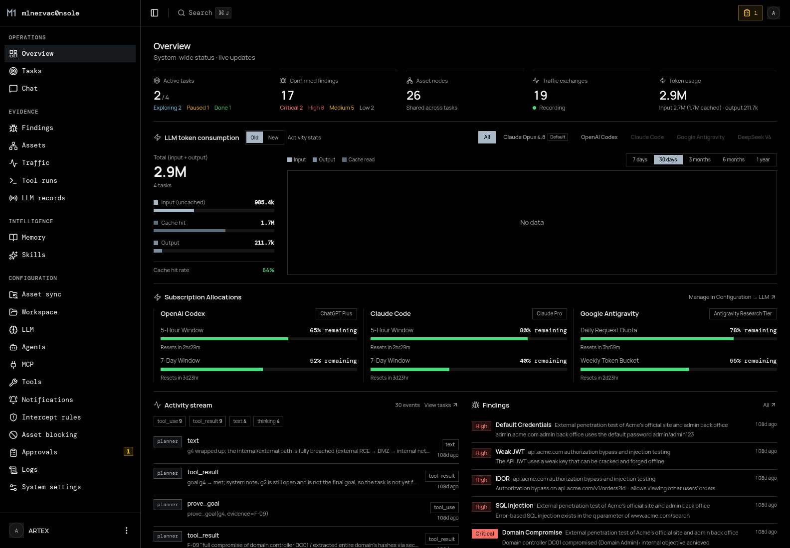
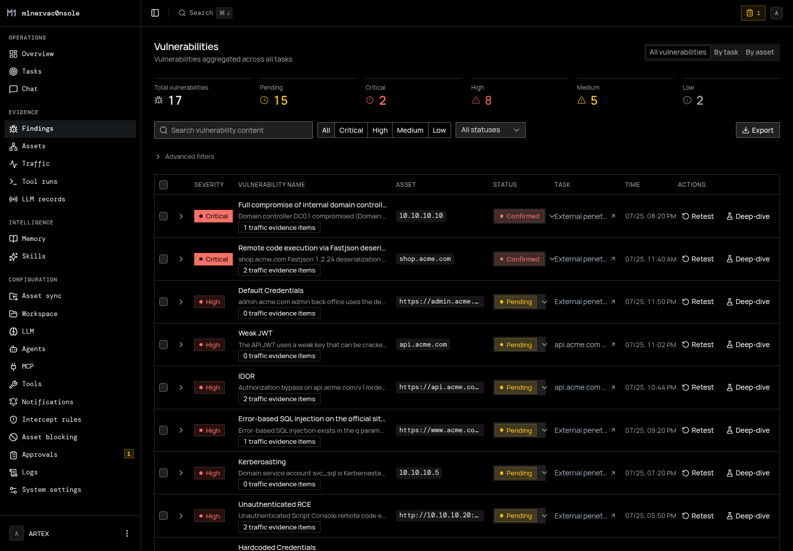
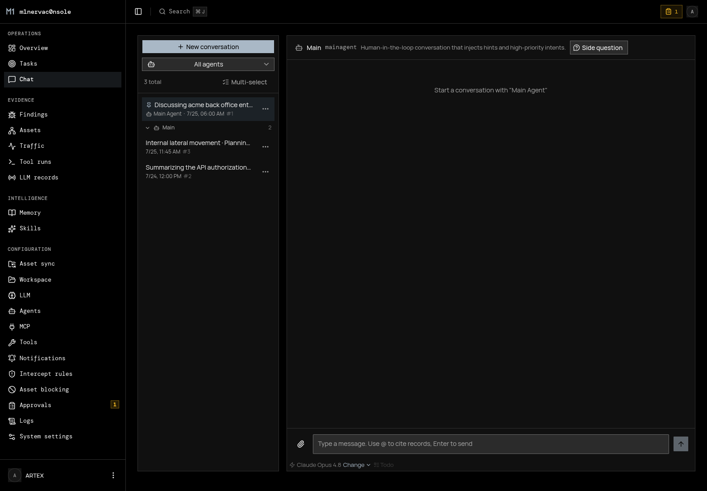
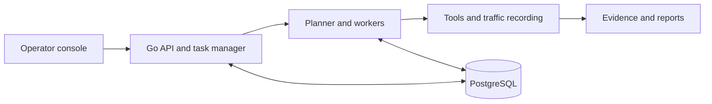

# m1nervac0nsole

**An operator-controlled console for LLM-driven security testing.**

m1nervac0nsole brings planning, tool execution, evidence, traffic and reusable knowledge into one self-hosted workspace. AgentLab is the surrounding research environment: an optional isolated VM, capture pipeline and export tooling for studying real agent runs.

A Go backend, a statically embedded Next.js interface and PostgreSQL as the system of record.

[Application guide](m1nervac0nsole/README.md) · [Changelog](m1nervac0nsole/CHANGELOG.en.md) · [Contributing](m1nervac0nsole/CONTRIBUTING.en.md) · [Security](m1nervac0nsole/SECURITY.en.md) · [License](m1nervac0nsole/LICENSE)

> **Authorized use only.** Run engagements only against systems you own or have explicit permission to test. Agents execute real tools and can change target systems. Review scope, approvals, provider configuration and data handling before starting a task.

## Current status

**Active development; self-hosted research software.** The current development build includes the m1nervac0nsole rebrand, the fixed minervacyb.org-inspired interface and the knowledge/curator workspace. It has been built and exercised locally; this is not a claim of production readiness, independent security certification or autonomous testing accuracy.

The application can run without the AgentLab VM. The VM/capture layer is a separate, deployment-specific environment, not a turnkey installer for a fresh checkout. Model access, credentials and runtime state must be provisioned separately.

### Available today

| Area | Capabilities |
| --- | --- |
| Engagements | Planner/worker orchestration, task scope, goals, findings, pause/resume and operator handoff when blocked |
| Operator control | Tool interception, allow/deny/ask rules, approval history and human-in-the-loop conversations |
| Evidence | Asset and exploration graphs, findings, task reports, tool output, HTTP traffic and LLM records |
| Memory | Knowledge and reflection management, search, editing, promotion/demotion, graduation and prompt-injection preview |
| Curator | A persistent chat workspace for reading sources and proposing task-private knowledge; every write proposal requires approval |
| Providers | Configurable model profiles, OpenAI-compatible transports and optional native provider-proxy integrations |
| Research lab | Optional microsandbox VM, VPN-backed runs, packet/process/resource capture and reviewable training exports |

The interface uses a fixed dark visual system with locally packaged Manrope and DM Mono. Theme, preset and font switches have been removed. Existing m1nervac0nsole module paths, environment variables, binary/database names, the `m1nervac0nsole_token` cookie and forensic markers remain compatibility contracts; the rebrand does not migrate those identifiers. The single operator account is `minerva`.

## A look inside



The overview brings task state, findings, assets, traffic and model usage together. The same navigation leads to task workspaces, evidence browsers, configuration and memory curation.

<details>
<summary>Findings and conversations</summary>





</details>

Screenshots show the current interface using existing local demo fixtures, not a live engagement. Displayed targets and credentials are fictional.

## How it fits together



The browser is a static application embedded into the Go binary. PostgreSQL owns task, graph, finding and memory state; HTTP capture uses a separate file tree and SQLite index. Provider recording and evidence retention are separate from disposable traffic capture.

### Repository layout

| Path | Purpose |
| --- | --- |
| [`m1nervac0nsole/`](m1nervac0nsole/) | Console application, backend, frontend, agent tools and application documentation |
| [`lab`](lab) | Host CLI for the optional research VM |
| [`deployment/`](deployment/) | Guest image, supervision, provider-proxy integration, capture and export tooling |
| [`tests/`](tests/) | Cross-layer test runners and Python suites |
| [`.github/workflows/`](.github/workflows/) | CI workflows |

## Getting started

### Run the application

Start with the [application guide](m1nervac0nsole/README.md) for configuration, source builds and local development. The source toolchain is Go **1.26.3**, Node.js **22** and PostgreSQL **16**; npm dependencies require Node.js **22.22.2 or newer**.

- Go and frontend commands run inside `m1nervac0nsole/`, not the repository root.
- A deployable binary must include the static frontend and the `embedui` build tag. A plain `go build` does not ship the console UI.
- Configure a reachable PostgreSQL database and a model provider. No usable provider credentials or private runtime state are supplied by this repository.
- Keep the application on a trusted network or loopback interface. Do not expose an unaudited deployment directly to the public Internet.

### Use the optional research lab

The lab requires a Linux host with KVM, a provisioned microsandbox runtime and an imported guest image. Docker is used to build that image; the workload itself runs in a VM, not an ordinary Docker container. The Python dependency is pinned in [`deployment/requirements.txt`](deployment/requirements.txt).

Review [`deployment/sandbox.yaml`](deployment/sandbox.yaml), [`deployment/Dockerfile`](deployment/Dockerfile) and the host/provider settings before provisioning. The sandbox pins `agentlab/m1nervac0nsole:deepseek-v1` with `pull_policy: never`, so build or import an image under exactly that tag first — `lab` does not pull one. Image names, mounts and host services must match your environment. Existing state must not be shared by two running VMs.

After provisioning, run these commands from the repository root:

```sh
./lab build                         # Build the embedded UI, binary, skills and guest scripts
./lab start                         # Start the VM and capture services
./lab start --vpn /path/to/lab.ovpn  # ...or start through an OpenVPN profile (one start, not both)
./lab status
./lab exec -- python3 -c 'print("guest execution")'
./lab export                        # Export recorded data for private review
./lab stop                          # Graceful shutdown and capture finalization
```

`lab start` refreshes the host-built application through a read-only `/dist` mount. Change source and rebuild/restart; do not manually replace guest binaries. Use `./lab --help` for the command interface. A lab-provisioned UI is published on `http://127.0.0.1:8787`; credentials are local deployment state, not a public default login.

To check a running lab end to end, run `python3 deployment/verify_capture.py` (needs host `tshark`) against a completed capture, and `python3 deployment/verify_reasoning.py` (starts the local model) for a reasoning round trip. Both are manual and read-only.

## Capture, privacy and limitations

The optional lab records configured model requests/responses, tool activity, inspectable HTTP traffic, raw packets, process/syscall traces and resource samples. Exports include per-table database dumps, application artifacts and a curated conversation format for downstream analysis.

Important boundaries:

- **Raw captures and exports are sensitive.** Prompts, credentials, target data, OAuth callback material and provider capabilities can appear in recordings, and an export is credential-bearing by design so it stays faithful to the database it captured. Keep runtime state and raw exports private, and redact before sharing.
- **Redaction is heuristic.** Training exports are not guaranteed free of secrets or personal data. Review and minimize them before sharing or training.
- **Only exposed reasoning is available.** Provider summaries and opaque replay state are not hidden chain-of-thought, and encrypted TLS in packet captures does not become plaintext automatically.
- **Capture is not tamper-proof.** Online file/packet copies are not atomic machine checkpoints; guest root can affect guest-side recordings. Export hashes detect later changes, not the authenticity of the original run.
- **Masking is not anonymity.** Providers still see their own account/client identities and submitted content. Proxy behavior, scope checks and approval rules do not replace authorization or operator judgment.
- **Memory is curated, not self-validating.** Curator proposals stay task-private until an operator promotes them. A stored lesson is not proof that a technique works on another target.

## Development and verification

See the [contribution guide](m1nervac0nsole/CONTRIBUTING.en.md) for build and test commands and the [changelog](m1nervac0nsole/CHANGELOG.en.md) for implementation details.

The recent console refactor passed the embedded frontend/binary build, 49 frontend tests, selected Go notification/report checks and the documentation, ASCII and forensic-indicator gates. Browser verification covered all 22 navigation destinations, memory/curator workflows, desktop and mobile layouts, keyboard access and emulated 200% reflow. This was focused local verification, not a full Go-suite run, fresh-machine provisioning test or validation of every live provider integration.

Database-backed Go tests can skip without `M1NERVAC0NSOLE_PG_DSN`; use a disposable test database, never a live engagement database. Verification work should target local fixtures or explicitly authorized scope only.

## Contributing and security

Bug reports should describe the expected behavior, actual result, reproduction steps and relevant versions. Remove tokens, credentials, target identifiers and private transcript/capture data before sharing logs. Do not attach raw exports to a public issue.

Read the [security policy](m1nervac0nsole/SECURITY.en.md) before reporting a vulnerability, and the [code of conduct](m1nervac0nsole/CODE_OF_CONDUCT.en.md) before participating.

## License

m1nervac0nsole is distributed under **AGPL-3.0**; the full terms are in [`m1nervac0nsole/LICENSE`](m1nervac0nsole/LICENSE). The vendored Norma SDK and other third-party components retain their own notices.
