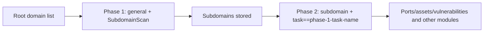

---

## name: scopesentry-mcp
description: Manage the ScopeSentry security scanning platform (projects, tasks, templates, assets, nodes) through the ScopeSentry MCP. Use when the user mentions ScopeSentry, MCP, API keys, scan tasks, or asset queries.

# ScopeSentry MCP Usage Guide

For users of a **deployed ScopeSentry instance**. Connect through Cursor (or another MCP client); no local source code is required.

## 1. Preparation

### 1.1 Confirm the Service Is Reachable

- Default web interface: `http://<host>`
- MCP endpoint: `http://<host>/mcp` (if a reverse proxy or frontend proxy sits in front, use the actual `/mcp` address)

### 1.2 Create an API Key

1. Sign in to the ScopeSentry web interface in your browser
2. Open the **API Key** management page and create a key (or have an administrator create one through the provided interface)
3. Save the returned `ssk_...` string (**it is shown only once**)

### 1.3 Configure Cursor MCP

Cursor → Settings → MCP → Add server:

```json
{
  "mcpServers": {
    "scopesentry": {
      "url": "http://<your-host>:8082/mcp",
      "headers": {
        "X-API-Key": "ssk_your-key"
      }
    }
  }
}
```

You can also use: `Authorization: Bearer ssk_your-key`

After configuring, restart MCP or reload Cursor, then confirm the tool list includes `list_projects`, `list_assets`, and others.

---

## 2. Tool Overview


| Tool | Purpose |
| ---------------------- | ----------------- |
| `list_projects`        | Project tree grouped by tags (includes project IDs) |
| `list_projects_data`   | Paginated project list, searchable by name |
| `get_project`          | Project details |
| `create_project`       | Create a project |
| `list_tasks`           | Scan task list |
| `get_task`             | Task details |
| `list_scan_templates`  | Scan template list |
| `get_scan_template`    | Template details |
| `list_plugin_modules`  | Scan pipeline module names |
| `list_plugins`         | Available plugins (including hash and default parameters) |
| `create_scan_template` | Create a scan template |
| `create_scan_task`     | Create a scan task |
| `list_assets`          | Query assets by type (paginated list) |
| `count_assets`         | Count assets (`/api/assets/common/total`) |
| `get_asset_detail`     | Asset or vulnerability details |
| `add_asset_tag`        | Add a tag to an asset |
| `list_nodes`           | Scan node list |


Tool parameters follow the MCP tool descriptions (schemas). `list_assets` and `count_assets` share the same search and filter syntax; read the `list_assets` description before querying assets.

To find out how many records match, use `count_assets` (it corresponds to the Web pagination total endpoint) instead of paging through `list_assets` repeatedly.

---

## 3. Common Workflows

### 3.1 Query Assets by Project

When the user or context **already has a project condition**, prefer `filter.project` to narrow the scope and avoid slow responses caused by too much cross-project data. If no project is specified, a project filter is not required.

1. Use `list_projects` or `list_projects_data` to get the target project's **ObjectID** (`id` / `children[].value`)
2. Pass `filter.project` to `list_assets` (**it must be an ID, not a project name**)

```json
{
  "asset_type": "asset",
  "pageIndex": 1,
  "pageSize": 20,
  "search": "domain=^example.com",
  "filter": {
    "project": ["<project-ObjectID>"]
  }
}
```

### 3.2 Create a Scan Task

1. Use `list_nodes` to get the names of online nodes
2. Use `list_scan_templates` or `create_scan_template` to get the template **ObjectID**
3. In `create_scan_task`, `name` and `node` are required; `template` takes the template ID (not the template name)

**Target source `targetSource` (consistent with the Web UI):**

| targetSource | Description | Required parameters |
| --- | --- | --- |
| `general` | Enter targets directly | `target` |
| `project` | Read targets from a project | `project` (array of project ObjectIDs) |
| `asset` | Search the Web asset library | `search`; optional `project`, `filter`, `targetNumber` |
| `RootDomain` | Search the root domain library | `search`; optional `project`, `filter`, `targetNumber` |
| `subdomain` | Search the subdomain library | `search`; optional `project`, `filter`, `targetNumber` |
| `UrlScan` | Search URL scan results | `search`; optional `project`, `filter`, `targetNumber` |
| `*Source` (e.g. `subdomainSource`) | Create from "select/search" on an asset page | `targetTp=search`: `search`; `targetTp=select`: `targetIds` |

**Example — scan root domains directly:**

```json
{
  "name": "example-subdomain-collection",
  "node": ["node-1"],
  "template": "<template-ObjectID>",
  "targetSource": "general",
  "target": "example.com\nfoo.com",
  "project": ["<project-ObjectID>"]
}
```

**Example — continue scanning from the subdomain library (filtered by the previous task name):**

```json
{
  "name": "example-ports-and-vulns",
  "node": ["node-1"],
  "template": "<follow-up-module-template-ObjectID>",
  "targetSource": "subdomain",
  "search": "task==\"example-subdomain-collection\"",
  "project": ["<project-ObjectID>"]
}
```

### 3.3 Full Root Domain Information Collection (Two Phases Recommended)

When the input is a **root domain** and you need **full information collection**, run two scans instead of a single full pipeline.

**Reason:** Distributed tasks are dispatched one **target** at a time. When a root domain is the target, subdomains discovered on the node that received it also run the subsequent modules on that same node, which causes uneven load, slow progress, and more errors.

**Best practice:**

1. **Phase 1 — subdomain collection only**
   - `targetSource`: `general`
   - `target`: all root domains (one per line)
   - Template: enable only `SubdomainScan` and `SubdomainSecurity` (subdomain scanning and subdomain takeover)
   - Use `get_task` to wait for the task to finish

2. **Phase 2 — subsequent modules**
   - `targetSource`: `subdomain`
   - `search`: `task=="<phase-1-task-name>"` (exact task-name match)
   - Optionally narrow the scope with `project`
   - Template: port scanning, asset mapping, vulnerability scanning, etc. (`SubdomainScan` can be omitted)
   - Subdomains are dispatched to nodes as independent targets, which improves parallel efficiency

Alternatively, on the Web UI "Subdomains" asset page, filter by task name and use "Create task from subdomains"; the result is the same.



### 3.4 Create a Scan Template

1. `list_plugin_modules` → list of module names
2. `list_plugins` (optionally filtered by `module`) → each plugin's `hash` and default `parameter`
3. `create_scan_template`: use `modules` to map each "module → array of plugin hashes"

---

## 4. Asset Queries (`list_assets` / `count_assets`)

`count_assets` and `list_assets` take the same `asset_type`, `search`, and `filter`. `count_assets` returns `{ "total": N }`, corresponding to the Web `/api/assets/common/total` endpoint.

```json
{
  "asset_type": "subdomain",
  "search": "task==\"some-task-name\"",
  "filter": {"project": ["<project-ObjectID>"]}
}
```

**Performance advice (`list_assets` / `count_assets`):** If a project condition exists, prefer `filter.project` to narrow the scope. In `search`, use `==` exact match or `^` prefix match on indexed fields where possible (see [4.3](#43-search-expressions)); avoid broad `=` fuzzy matches, which slow responses. Without project context, a project filter is not required.

For asset types that support `filter.project`, see the table in [4.4](#44-exact-filters).

### 4.1 Asset Types `asset_type`

`asset`, `RootDomain`, `subdomain`, `app`, `mp`, `UrlScan`, `SensitiveResult`, `DirScanResult`, `crawler`, `vulnerability`, `PageMonitoring`, `IPAsset`, `SubdomainTakerResult`

Aliases: `web`→asset, `vuln`→vulnerability, `ip`→IPAsset, `url`→UrlScan

### 4.2 Parameter Descriptions


| Parameter | Description |
| ------------------------ | --------------------------------------- |
| `pageIndex` / `pageSize` | Pagination, default 1 / 20 |
| `search` | Search expression (see below) |
| `filter` | Exact-match filter JSON (see below) |
| `sort` | Only UrlScan and DirScanResult support sorting by `length` |
| `sid` | SensitiveResult only: sensitive rule name |


`search` and `filter` **can be used together**.

### 4.3 Search Expressions

Custom DSL (**not SQL**):


| Operator | Meaning | Index | Example |
| ---- | ---- | ---- | --------------------------- |
| `=` | Fuzzy match (regex) | Not indexed | `domain=example` |
| `==` | Exact match | **Indexed** | `port==443` |
| `!=` | Exclude | — | `port!="80"` |
| `&&` | AND | — | `domain==example.com && port==443` |
| `||` | OR | — | `title=admin || body=login` |


**Indexes and operators:** Fields such as `domain`, `ip`, `port`, and `title` are indexed, but only **`==` exact matches** or prefix matches written with a leading `^` (e.g. `domain=^example.com`) can use the index. **`=` is converted to a regex fuzzy match and cannot use the index**, which can be slow on large datasets.

**Search fields available for all types:** `tag`, `task` (task name), `rootDomain`

**`project` cannot be used in `search`** (it is invalid, and combining it with `&&` causes an error). Filter by project with `filter.project`.

**Common search fields by type:**


| asset_type           | Fields                                                                              |
| -------------------- | ----------------------------------------------------------------------------------- |
| asset                | domain, ip, port, service, app, title, statuscode, icon, banner, type, body, header |
| RootDomain           | domain, icp, company                                                                |
| subdomain            | domain, ip, type, value                                                             |
| app                  | name, icp, company, category, description, url, apk                                 |
| mp                   | name, icp, company, category, description, url                                      |
| UrlScan              | url, input, source, resultId, type                                                  |
| SensitiveResult      | url, sname, body, info, md5                                                         |
| DirScanResult        | url, statuscode, redirect, length                                                   |
| vulnerability        | url, vulname, matched, request, response, level                                     |
| crawler              | url, method, body, resultId                                                         |
| PageMonitoring       | url, hash, diff, response                                                           |
| IPAsset              | ip, domain, port, service, webServer, app                                           |
| SubdomainTakerResult | domain, value, type, response                                                       |


**Search examples:**

- `domain==www.example.com && port==443` (exact match, uses index)
- `domain=^example.com` (prefix match, uses index)
- `ip==192.168.1.1`
- `task=="some-task-name"`
- `level==high` (vulnerability)
- `statuscode==200` (DirScanResult)

Use `=` only when fuzzy containment is needed, e.g. `title=admin` (not indexed; preferably narrow the scope with a project or other conditions).

### 4.4 Exact Filters

JSON object: multiple values for the same key are **OR**; different keys are **AND**.

**When a project condition exists, prefer `project`:** If the user or context has clearly specified a project and the asset_type supports `project`, include it to narrow the scope; do not force it when no project information is available.


| filter key   | Meaning | Values |
| ------------ | -------- | -------------------------------------------------------- |
| `project`    | Owning project | **ObjectID**, obtained with `list_projects` / `list_projects_data` |
| `task`       | Source task | **Task name**, the `name` from `list_tasks` |
| `port`       | Port | e.g. `"443"` |
| `service`    | Service/protocol | e.g. `"https"` |
| `app`        | Application fingerprint | e.g. `"Nginx"` |
| `icon`       | Icon hash | |
| `statuscode` | HTTP status code | Mainly for asset |
| `status`     | Status | UrlScan/DirScan HTTP code; processing status for vulnerabilities/sensitive data |
| `level`      | Vulnerability level | critical / high / medium / low / info |
| `type`       | Type | e.g. subdomain record type A, CNAME |
| `color`      | Sensitive rule color | SensitiveResult |
| `sname`      | Sensitive rule name | SensitiveResult |
| `tags`       | Tags | |


**Filter keys available by type:**


| asset_type                            | filter key                                                      |
| ------------------------------------- | --------------------------------------------------------------- |
| asset                                 | project, port, service, app, icon, statuscode, type, task, tags |
| RootDomain                            | project, tags                                                   |
| subdomain                             | project, type, task, tags                                       |
| app / mp                              | project, tags                                                   |
| UrlScan                               | status, tags                                                    |
| DirScanResult                         | status, tags                                                    |
| SensitiveResult                       | status, color, sname, tags                                      |
| crawler                               | project, task, tags                                             |
| vulnerability                         | project, level, status, task, tags                              |
| PageMonitoring / SubdomainTakerResult | tags                                                            |
| IPAsset                               | project, port, service, app                                     |


**Filter example:**

```json
{"project": ["<project-ObjectID>"], "port": ["443"]}
```

**Combined query example:**

```json
{
  "asset_type": "asset",
  "search": "domain=^baidu && port==443",
  "filter": {"project": ["<project-ObjectID>"]},
  "pageIndex": 1,
  "pageSize": 10
}
```

**Notes:**

- When a project condition exists, prefer `filter.project` (if supported); it is not required without project context
- Do not put the project's display name in `filter.project`
- Use `==` for known values and `^` for prefixes; avoid overusing fuzzy `=` matching on large tables
- For UrlScan HTTP status, use `filter.status`; for DirScanResult, you can use `statuscode==200` in `search`
- For SensitiveResult by rule name, use `sname=rule-name` in `search`, or `filter.sname`

### 4.5 Sorting `sort`

Supported only for **UrlScan** and **DirScanResult**:

```json
{"length": "ascending"}
```

Other types ignore `sort` and use the default time ordering.

---

## 5. Scan Template Module Names

`TargetHandler`, `SubdomainScan`, `SubdomainSecurity`, `PortScanPreparation`, `PortScan`, `PortFingerprint`, `AssetMapping`, `AssetHandle`, `URLScan`, `WebCrawler`, `URLSecurity`, `DirScan`, `VulnerabilityScan`, `PassiveScan`

---

## 6. Troubleshooting


| Symptom | Action |
| --------- | -------------------------------------------------- |
| No MCP tools | Check the URL and API key, and confirm ScopeSentry is running |
| 401 / 403 | Recreate or replace the API key |
| No assets found | Confirm `filter.project` is an ObjectID; do not put `project` in `search` |
| Template/task creation fails | `template` must be the template ObjectID; `node` must be an online node name |
| Slow or stuck queries | With a project, add `filter.project`; for indexed fields in `search`, use `==` or the `^` prefix and avoid `=`; reduce `pageSize` |


---

