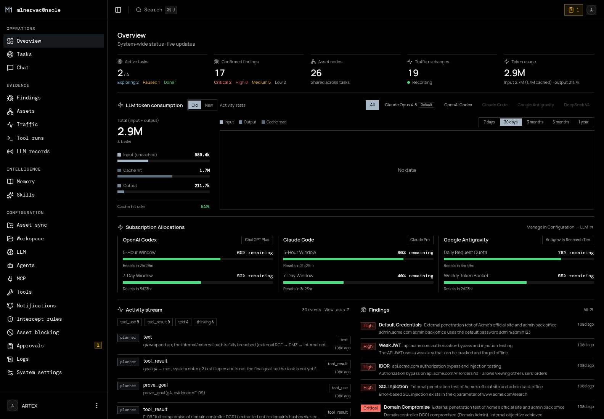
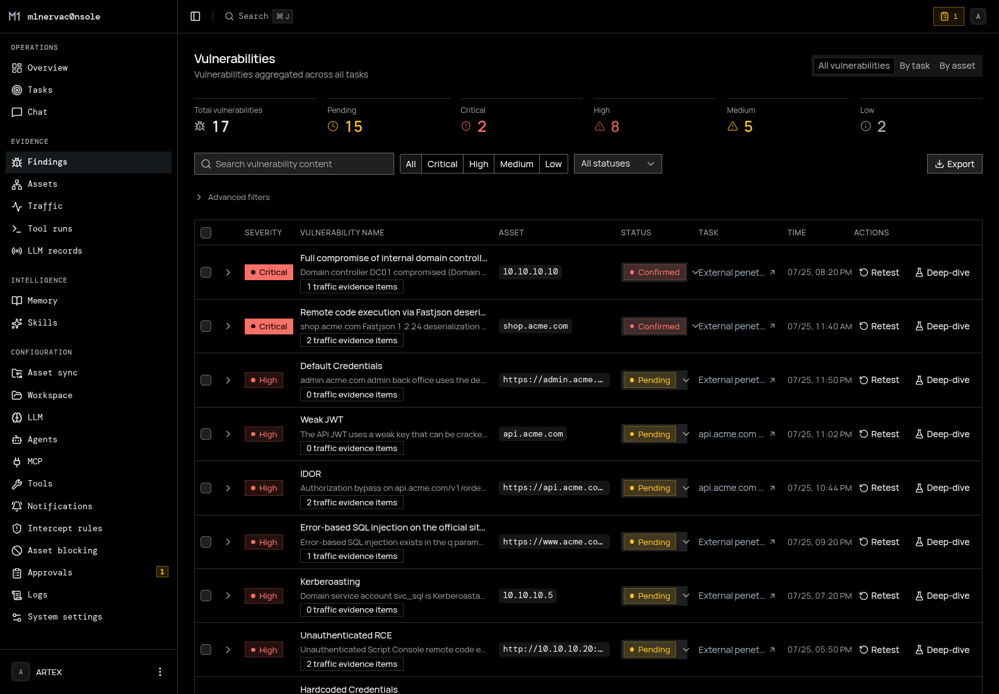
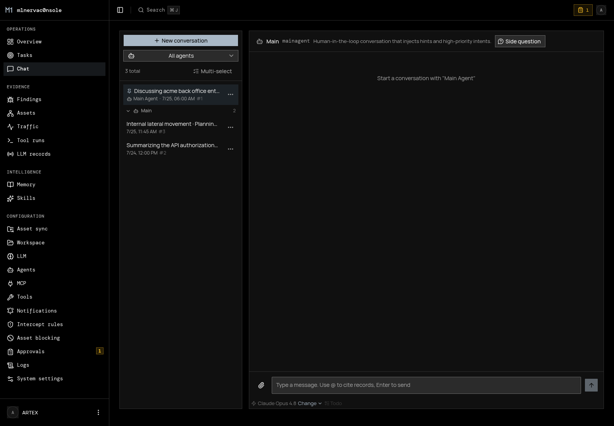

# m1nervac0nsole

An **operator-controlled console for authorized security research**, based on [ARTEX](https://github.com/structuredstanza/ARTEX) and extended with a recursive self-improvement (RSI) loop. LLM-driven agents break an engagement goal into intents, run real tooling against an approved scope, and record every asset, fact, finding and captured exchange for a human to review.

This is the application guide for the tree in this directory: requirements, build, first run, configuration, safety controls, known limits and development. For the project overview, the microsandbox lab deployment and the capture/export pipeline, see the [repository README](../README.md).

> **Authorized use only.** Run this console only against systems you own or have explicit written authorization to test. See [Read first](#️-read-first--authorized-use-and-legal-notice) and [License and disclaimer](#license-and-disclaimer) before you start it.

## ⚠️ Read first — authorized use and legal notice

m1nervac0nsole is an autonomous offensive tool. Misuse causes real harm, and unauthorized use is a crime in itself.

- Use it **only** against targets you own or for which you hold explicit written authorization, within an agreed scope and time window. Do not target live services or other parties' assets.
- Verify in locally isolated environments you own — deliberately vulnerable targets such as OWASP Juice Shop or DVWA.

Starting the console constitutes agreement to the full terms in [License and disclaimer](#license-and-disclaimer).

## Current state

The console, its HTTP API and the embedded UI are implemented and exercised in this working tree. What is here today:

- **Autonomous tasks** — a planner emits intents, N workers execute them with Bash, HTTP and manifest tools, and results accumulate in a per-task exploration graph. Tasks can be paused, resumed or given extra goals, and a planner that cannot advance calls `report_blocked`, parking the task in `needs_operator` with a reason and a concrete operator action.
- **Shared asset graph** — domains, subdomains, IPs, services, apps and endpoints belong to companies; per-task scope, exclusions and an approximate coverage view derive from it.
- **Findings** — severity/status/asset/task views, retests, linked traffic evidence, report review, and export as Markdown, CSV or JSON.
- **Evidence and collaboration** — recording proxy, tool-run history, LLM request records, optional browser-extension capture, and human-in-the-loop chat with the main agent.
- **Memory** — a knowledge base and per-task reflection pool with a cross-task browser, prompt preview, and a propose-only curator whose writes require operator approval.
- **Configuration surfaces** — skills, MCP servers, custom tools, agent bindings, intercept rules, asset intercept, approval records, notifications, logs and system settings.

This is a development tree, not a hardened production release. No release artifact, hosted instance or support commitment is implied; build and verify it yourself with the commands below.

Beyond its [ARTEX](https://github.com/structuredstanza/ARTEX) base, this tree adds the RSI memory loop ([RSI.md](RSI.md): knowledge base, reflection pool, propose-only curator, owner-gated promotion), the recording-proxy-plus-gateway authorization boundary, `execbox` subprocess isolation with the scoped direct lane, evidence pinning, split research/testing browser roles and the English-only source discipline. The repository README's ["Relationship to upstream ARTEX"](../README.md#relationship-to-upstream-artex) has the full comparison with diagrams.

## Screenshots

Current UI with the existing local demo fixtures (`NEXT_PUBLIC_MOCK=1`), not a live engagement. Targets, addresses and credentials shown are fictional.


*Dashboard — active tasks, confirmed findings, asset nodes, token spend and the activity feed.*


*Findings — aggregated by severity, status, asset and owning task. Finding titles are model-generated and may quote target terminology.*


*Chat — a human steps into a running task to add context while the agent summarizes the chain.*

## Requirements

- **Go 1.26.3** — pinned by `go.mod`; `build.sh` requires Go 1.26 or later. The server is pure Go (`CGO_ENABLED=0`), so no C toolchain is needed.
- **Node.js 22 with npm** — the version CI builds the frontend with; `web/package.json` declares no `engines` pin.
- **PostgreSQL 16** — the version used by `docker-compose.yml` and CI. The schema is created and migrated idempotently at startup.
- **rsync** — required by `build.sh` to sync the static export into the embed directory.
- **Docker + Compose** — optional, for the container path only; the image is built locally.
- **LLM endpoint** — an Anthropic or OpenAI API key, or any OpenAI-compatible endpoint set in the UI.

The console drives real tools; install what your engagements need. The container image bundles `nmap`, `ripgrep`, `curl`, `nuclei`, `httpx`, `subfinder`, `katana`, `ffuf`, `dalfox`, `sqlmap`, `bbot` and Obscura (the research browser). It installs no testing browser: Chromium comes from the guest image (see [Browser roles](#browser-roles)).

The AgentLab root additionally provides a microsandbox VM deployment (`./lab`). That path is site-specific — `deployment/sandbox.yaml` mounts absolute host paths and pins a locally imported image — so it is not a portable installer. On a fresh checkout, use the source build below.

## Build from source

The frontend is a static export embedded into the Go binary with `go:embed`. The `embedui` build tag is what includes it; without that tag the binary serves a 404 for the UI.

```bash
cd web && npm ci && npm run build:static && cd ..                       # 1) static frontend
rm -rf server/webui/dist && mkdir -p server/webui/dist \
  && cp -a web/out/. server/webui/dist/                                 # 2) into the embed dir
CGO_ENABLED=0 go build -tags embedui -o m1nervac0nsole ./cmd/m1nervac0nsole               # 3) one binary
./start.sh                                                             # 4) supervised run
```

`./build.sh` runs steps 1–3 and writes `dist/m1nervac0nsole-<os>-<arch>/m1nervac0nsole` plus `dist/<arch>/m1nervac0nsole` (the path the Dockerfile copies). `M1NERVAC0NSOLE_OUTPUT` overrides the output path, `M1NERVAC0NSOLE_TARGETS=linux/amd64,...` selects targets, and `M1NERVAC0NSOLE_SKIP_FRONTEND=1` reuses an existing `server/webui/dist`.

> If your shell exports `NODE_ENV=production`, `npm ci` skips devDependencies and the build fails on `@tailwindcss/postcss`. Use `npm ci --include=dev`.

Before starting the binary, point it at PostgreSQL through `config.json` or `M1NERVAC0NSOLE_PG_DSN`. There is no built-in database fallback: startup fails loudly naming the config path it inspected.

## Run with Docker Compose

```bash
cp .env.example .env            # set POSTGRES_PASSWORD; an API key is optional
./build.sh                      # the image copies dist/<arch>/m1nervac0nsole
docker compose build m1nervac0nsole      # builds agentlab/m1nervac0nsole:local from the Dockerfile
docker compose up -d            # m1nervac0nsole + postgres
docker compose logs m1nervac0nsole | grep -F '[auth]'   # first-run setup token
# → http://localhost:8787/setup
```

The stack publishes the UI/API on `127.0.0.1:8787` and the recording proxy on `127.0.0.1:8788`, and bind-mounts `./data` and `./skills` so they survive container recreation. The image is always built from this tree; nothing pulls or overwrites it with a stock upstream image.

`./install.sh` wraps the same choice (all-in-Docker, or local compile with an existing or Docker-provided PostgreSQL), and `./update.sh` rebuilds this tree and restarts it. Neither runs `git pull`: upstream changes are reviewed and merged into this tree first.

## First run and the admin account

There is a single admin account, `minerva`. Its password is created on the first visit at `/setup`, and three protections stop a stranger from claiming an uninitialised instance:

- **Setup token** — until a password exists, the server prints one `[auth] … Setup token: …` line to the console and `/setup` requires that value. Pin it with `M1NERVAC0NSOLE_SETUP_TOKEN`, or set the password directly with `M1NERVAC0NSOLE_ADMIN_PASSWORD` (8+ characters) for unattended installs.
- **Loopback by default** — `-addr` defaults to `127.0.0.1:8787`, and compose publishes on `127.0.0.1` unless `M1NERVAC0NSOLE_BIND` says otherwise. Finish setup before exposing the port.
- **Password-bound sessions** — the token signing key is derived from the password hash, so changing the password (UI, `reset-password.sh`, or a direct database edit) invalidates every issued session within seconds.

`M1NERVAC0NSOLE_CORS_ORIGINS` (comma-separated) is the only cross-origin allowlist for `/api`; the embedded UI is same-origin, and the default only admits `next dev` on `:5173`. Behind a reverse proxy, terminate HTTPS and keep `:8787` internal; the UI and SSE stream are same-origin, so no extra base URL is needed — but **disable response buffering** in the proxy, or the stream connects and never delivers events.

## Configuration

**Database.** `M1NERVAC0NSOLE_PG_DSN` wins over the config file. `config.json` is resolved from `M1NERVAC0NSOLE_CONFIG`, then `./config.json`, then beside the executable:

```json
{
  "database": {
    "host": "127.0.0.1", "port": 5432, "user": "m1nervac0nsole", "password": "yourpass",
    "dbname": "m1nervac0nsole", "sslmode": "disable"
  }
}
```

`database.dsn` may replace the individual fields. The `-data` directory (default `data/` beside the executable) holds `jwt.key` and the traffic recorder's SQLite index; keep it across upgrades. Skills resolve from `M1NERVAC0NSOLE_SKILL_DIR`, then `skill_dir`, then `skills/`.

**LLM.** Set `ANTHROPIC_API_KEY` or `OPENAI_API_KEY`, or enter a key on the LLM settings page. `M1NERVAC0NSOLE_LLM_PROVIDER`, `M1NERVAC0NSOLE_LLM_MODEL`, `M1NERVAC0NSOLE_LLM_BASE_URL` and `M1NERVAC0NSOLE_LLM_PROXY` configure a profile without the UI; point `M1NERVAC0NSOLE_LLM_BASE_URL` at an OpenAI-compatible endpoint for a local or open-weight model. Worker concurrency per task is set under **System Settings** (default 3), and the task concurrency limit is off by default.

**Memory.** `M1NERVAC0NSOLE_MEMORY=off` disables injection of knowledge and reflections; the default is `inject`. See [RSI.md](RSI.md) for the store, write-time scrubbing and promotion rules.

**Flags.** `./start.sh -addr :8787 -proxy 127.0.0.1:8788` — `-addr` is the UI/API listener (default loopback only), `-proxy` the traffic-recording proxy (empty disables it), `-data` the data directory.

### Model selection

Agent output is **requested** in English by the prompts; the server does not rewrite or enforce the model's response language. A capable model follows that instruction more reliably, and short structured fields may still quote the target's own terminology. Reasoning models need a generous `max_tokens`, or internal reasoning can consume the budget and leave the answer empty. OpenAI-family models cap response tokens at 16,384 while OpenAI-compatible requests default higher, so an unchanged profile can fail with `400 (max_tokens is too large)`; set that profile's `max_tokens` to 16,384 or lower.

### The recorder, gateway and scoped direct lane

Recorded HTTP goes through the recording proxy (`-proxy`, default `127.0.0.1:8788`) and gateway. The gateway authorizes each request, resolves and pins the origin, applies the operator's global proxy when configured (otherwise direct), and uses Chrome uTLS for origin TLS. A backend-issued session credential identifies purpose, task and policy revision; absent, unknown or revoked credentials are refused.

The gateway selectively replaces missing or recognized tool-default User-Agent values, preserving deliberate custom identities and caller credentials. Stealth uses `navigation` masking (browser-like headers for eligible bodyless GET/HEAD requests); Careful, Standard and Unbound use `ua` masking on recorded traffic. Enrichment uses recorded gateway sessions with navigation masking. There is no separate masking-egress process, package, subcommand or environment configuration.

Profiles express operator guidance, not enforced request-rate or thread ceilings. Tool-run concurrency defaults to 16 globally and per target.

The backend wraps the installed execbox client for **all testing subprocesses**, including SDK/Bash, custom scripts and manifests. A testing session can receive a scoped direct lane only with live `tun0` and no operator global proxy; research/install remain relay-only. Interactive HTTP keeps recorder proxy environment settings. Only Standard/Unbound bulk-HTTP manifests declaring `RateRPS` remove both proxy environment and proxy argv after a lane snapshot is available; execution refuses if the lane disappears. Raw tools can use scoped direct sockets regardless of HTTP proxy environment.

Direct traffic is IPv4-only, unmasked and absent from HTTP recordings. Keep execution artifacts and pinned pcap evidence; replay safe HTTP through the recorder when inspectable evidence is needed. The session link has no IPv6. See the [network reference](docs/design/network-layer.md) for packet enforcement, DNS learning and revocation.

### Browser roles

Two browsers, two purposes, and no agent can promote itself from one to the other:

- **Research — Obscura.** The `obscura` MCP server (`obscura mcp --stealth`) reads public documentation, repositories, advisories and vendor pages. It needs no task, so chat can use it; it exposes reading and extraction only (no evaluate, cookies, fill or click), and it refuses engagement targets and private, loopback, link-local and metadata addresses, including after a redirect.
- **Testing — native Chromium.** The `browser_*` tools drive Chromium over CDP (`server/browser_registry.go`, `browser/`) inside a task, under that task's scope, with the live view, upload/download, dialog handling and operator take-over. Unbound chat has no testing browser.

Both reach the network through the gateway, so their traffic is recorded and judged at the same boundary. The testing browser needs the guest deployment: the driver launches Chromium from `M1NERVAC0NSOLE_CHROMIUM`, else `/opt/ms-playwright/current/chrome`, else `/usr/bin/chromium`, and it runs it through the execbox supervisor, which the container image does not provide.

## System architecture

A single Go backend serves the API, the SSE stream and the embedded Next.js UI, with PostgreSQL as the application store (the traffic recorder keeps its own SQLite index under `data/`). Agent capabilities come from the owned [Norma SDK source](third_party/norma), based on BaaRai/Norma v0.4.6.

- **Dual graph.** The asset graph is global truth about what exists; the exploration graph is per-task progress (`goal → intent → fact → finding`). Anchors pin exploration nodes to assets, so either direction is queryable.
- **Engine.** Graph changes wake the planner; it emits intents only when there is a new direction; a worker claims one intent, executes it, and writes results back. A per-task todolist keeps a dependent attack chain ordered across fresh planner sessions.
- **Process-level exchange.** Workers can search other workers' execution traces in the same task, so an observation that never became a formal fact is still reusable.
- **Supporting packages.** `traffic` (recorder), `gateway` (origin transport and selective identity masking), `execbox` (subprocess isolation and scoped direct lane), `enrich` (async probes), `guard` and `intercept` (scope and approval), plus MCP, skills, memory and reporting.

## Safety controls in the code

- **Scope is enforced where work is dispatched.** Task scope rows and exclusions are checked at the worker and enrichment-dispatch layers, including redirects; the asset gate, scope checker and intercept enabled-tool cache fail closed when they cannot read their rules.
- **Intercept rules and approvals.** Tool calls are matched against DB-backed regex rules; a match raises an operator approval card and the decision is recorded. Memory-curator writes are approval-required in the interceptor itself, so an empty rule table cannot silently allow them.
- **Blocked instead of looping.** A planner that cannot advance a task calls `report_blocked`; the task moves to `needs_operator` with a reason and a concrete action, and both loops stop until a human resumes it.
- **Writes are scrubbed.** Agent-written memory is generalized and credential-scrubbed at write time, stays private to its task, and promotion to company or global scope is an owner action.
- **First-run protection** — setup token, loopback bind and password-bound session keys (above).

Root-namespace FORWARD rules enforce direct-lane authorized scope, exclusions and infrastructure denies in both directions, including established flows. Denies cover loopback, `10.98.0.0/16`, link-local, guest-local addresses, `host.microsandbox.internal` and configured native-provider/profile endpoints, not entire VPN destination ranges. DNS A learning is filtered, expires with TTL and is re-evaluated on policy updates. Refresh polls every second with a combined one-second policy read/apply deadline: revocation normally takes at most about two seconds plus kernel teardown/scheduling. Failure cancels processes without an old-policy fallback; a supervisor apply failure kills the session.

## Known limits

- English output is a prompt instruction, not a server-enforced guarantee; some role- and context-dependent drift remains, and structured finding fields can mirror the target's terms.
- Deleting or archiving a task removes only that task's captured exchanges. Rows recorded before attribution and the legacy per-host tree stay until an explicit host or all delete.
- WebSocket exchanges store a JSONL transcript of both directions, ordered by proxy arrival; control frames (ping/pong) are not observable at that layer.
- Single admin account, same-origin UI, no multi-tenant roles. Treat it as a single-operator research console, not a shared service.
- Gateway masking approximates browser identity, not anonymity or an identical fingerprint across protocols; direct traffic receives no masking or HTTP recording.
- Origin certificates are verified strictly unless a session has an explicit authority-specific exception; certificate-pinned clients and non-HTTP protocols are not inspectable.
- Enrichment retains the first 256 KiB of larger or interrupted observations with a partial marker; complete HTTP exchanges are recorded by the gateway session.
- The browser-capture extension is unpacked and manual: it needs the `debugger` permission and a separate controlled browser profile, and is not installed by the deployment.
- Memory retrieval is PostgreSQL full-text search, not embeddings; semantic recall is not implemented.
- Updates are local rebuilds of this tree: no self-update client or automatic upstream merge.
- Toolbox installs publish through the wrapped execution client; a genuinely refused publish is a failed install by design.

## Development

```bash
./dev.sh    # backend :8787 · recording proxy :8788 · next dev :5173
```

`./dev.sh` builds the backend first and tears down only its own process groups. For separate terminals: `go run ./cmd/m1nervac0nsole` (no `embedui` tag, so no embedded UI) and `cd web && npm run dev` (proxies `/api` to the backend).

```bash
go test ./...                                    # DB-backed tests skip without PostgreSQL
go test github.com/structuredstanza/norma/...    # nested SDK module
cd web && npm run test -- --run                  # vitest
cd web && npm run check                          # biome lint/format/a11y
cd web && npm run build:static                   # export build (includes type check)
python3 -I scripts/check-doc-links.py            # internal links, images and anchors
```

CI workflows live at the repository root in `.github/workflows/` (`ci.yml`, `web.yml`, `docs.yml`) and run these commands against PostgreSQL 16 and Node 22. Mock preview without a backend: `cd web && NEXT_PUBLIC_MOCK=1 npm run dev` — the same fixtures the screenshots use.

| Path | Contents |
|---|---|
| `cmd/m1nervac0nsole`, `server` | Entry point, flags, HTTP API, auth, SSE, embedded UI handler |
| `agent` | Goals, planner, worker, main agent, prompts, providers |
| `db` | PostgreSQL store, schema, migrations, seeds |
| `traffic`, `gateway`, `execbox`, `enrich`, `guard`, `intercept` | Recording, origin transport, subprocess isolation, async enrichment, scope checks, approval gate |
| `web` | Next.js app; `web/out` is the export embedded into the binary |
| `third_party/norma`, `docs` | Owned SDK source, design docs |

## Names

The product name is **m1nervac0nsole**, and every deployment identifier uses it: the Go module, the source directory, the binary, the database and role, the `m1nervac0nsole_token` cookie, the `M1NERVAC0NSOLE_*` environment variables, the `agentlab/m1nervac0nsole` image and the `m1nervac0nsole-agentlab-*` sandbox prefix. The single operator account is `minerva`.

- Agent SDK: owned [Norma source](third_party/norma), based on [BaaRai/Norma v0.4.6](https://github.com/BaaRai/Norma/tree/v0.4.6), Apache-2.0; its license and modification notices travel with the source.
- Changes in this edition are tracked in [CHANGELOG.en.md](CHANGELOG.en.md).

## License and disclaimer

This project is distributed under the **GNU Affero General Public License v3.0 (AGPL-3.0)**; the full terms are in [LICENSE](LICENSE). Derivative works must also be released under AGPL-3.0, and if you modify the project and provide it to users over a network you must offer those users the corresponding complete source.

An open-source license does not restrict use by itself. In addition: use the tool to read and study the source and to verify its behavior in a locally isolated environment you own or are explicitly authorized to test; do not scan, probe, exploit or attack any system without explicit written authorization; do not use it for illegal intrusion, data theft, denial of service or any other destructive or criminal activity; and comply with the law of your jurisdiction.

The project is provided **"AS IS"**, without warranty of any kind. The authors and contributors are not liable for direct or indirect damage, data loss, system damage or legal dispute arising from its use. Downloading, installing or using it constitutes agreement to these terms; all legal responsibility rests with the user.
