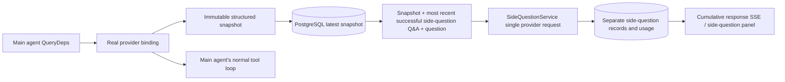

# `/btw` Side Questions

English

Ordinary chat, the MainAgent of a task, and the Workers that the current task launched directly each support side questions that are separate from the main conversation. Type `/btw question` in the main input box to submit a side question. Type `/btw` with no content, or press the "Side question" button, to open the history of previous side questions. On desktop they appear in a sidebar whose width you can adjust; on mobile they appear in a drawer.

A side-question answer is generated from a snapshot of the agent context taken at the moment the question was submitted. It supports streaming output, follow-up questions, stopping, and clearing. Closing the panel, reloading the page, or losing the SSE connection does not cancel the model request. Stopping affects only the one side question currently running. Clearing cancels the side question and also deletes the side-question history, but leaves the main context snapshot in place.

## Implementation scope

Go, norma v0.3.7, Next.js, and the existing Markdown, ResizablePanel, Drawer, and AlertDialog components are used as they are. The norma source was not modified and no new dependency was added for side questions. Promotion of Planners, Workers inherited from other tasks, and tool-style subtasks is outside this scope.

- `capture.go` marks a request as a main-loop request only in `Options.Deps.CallModel` and `CallModelSync`. The provider decorator sits inside an individual model, that is, after the routing pool has picked a model, so it records the model actually selected. Compaction and summarization requests do not overwrite the snapshot.
- Snapshots are published when a request starts, when the model finishes its response, and when the run reaches a terminal state. A half-finished response that is still being generated is not published. Tool calls stay paired through norma's `MessagesForAPI`, and tool results enter the snapshot at the next main-model request or at the terminal state of the run. If streaming is interrupted, the last valid boundary is kept.
- Snapshots preserve structured messages, the system prompt, tool definitions, and generation parameters through a deep JSON copy. Model inference holds neither a snapshot lock nor a database transaction.
- `SideQuestionService` calls an individual provider. When needed, it first produces a side-question summary. The final response is retried once with a reduced context, and only when the context has for the first time exceeded the limit and no text or tool call has been emitted yet. It does not create a new agent session, does not connect to the tool executor, the main transcript, the activity stream, or the task graph, and does not go through the task model-switching chain. The response keeps tool definitions so that it stays compatible with the existing structured tool context; summary requests are given no tools. Tool calls newly returned by the model have no execution path.
- Each parent session has at most one running request, each service process has at most four, and each request has a time limit of 120 seconds. Side questions use an independent cancellation context under the service lifecycle.
- A side-question request stores a reference to the model configuration and a non-sensitive summary of its identifying information. It fetches credentials from the existing configuration at the time the request is made. If the configuration is deleted, or identifying fields such as the model, protocol, or address change, the user is first required to run the main agent so the snapshot is refreshed. Tests do not change the product's default model.

## Persistence and recovery

`db/schema.sql` creates the `side_question_sessions` and `side_question_requests` tables automatically. The first table stores the parent resource, the latest snapshot, the run number, the version, and the cleanup version. The second stores the question, the cumulative response, the status, the model, the snapshot time, usage, the event sequence number, and the page sequence number.

The parent session key is either the conversation ID or the task ID, intent ID, and exploration ID combined. Workers do not use a reusable execution-slot name.

Snapshots are recorded by merging at the parent-session level and are flushed once every 250 milliseconds. The database compares `(run_id, version)` so that an older version cannot overwrite a newer one. Just before a side question is submitted, the selected snapshot is saved once more. On a successful save, the large in-memory snapshot is released; on failure, the unrecorded version is kept. Cumulative response content is written at most once every 250 milliseconds as streaming events arrive. On a terminal status it is saved immediately, and if the database returns an error it is retried a limited number of times.

When the service starts, any request left in `running` from before is marked `interrupted`. Partial responses and usage that were already stored in the database are left as they are, and the request is not automatically run again. The most recently successfully saved context is immediately available for the next question. If an old session has no snapshot, the user is first required to run the main agent, and the context is not rebuilt from the UI activity log.

A clear operation increments the cleanup version and deletes the requests. A conditional update prevents a late-arriving callback from writing again. When a parent resource is physically deleted, foreign-key cascades handle the side-question data. When a Worker is logically deleted, the side-question data is deleted in the same transaction, and a snapshot that arrives later is rejected. When archiving a task, new requests are blocked first, the main flow is waited on to stop, side questions are cancelled, and then the database is waited on to reflect the changes. The archive format is v3 and is compatible with v1 and v2, which do not have the side-question tables.

Records are always stored in full. The list returns up to 20 items per page, using a sequence cursor. Model requests include the full text of up to 20 of the most recent successful question-and-answer pairs, with that amount limited to the token budget. Older pairs are managed as a separate rolling summary. When the main context exceeds the budget, only the old portion of the side-question copy is summarized, and the most recent structured tool calls and their results are kept. Summaries, preparation progress, and usage all fall under the side-question rules for concurrency, cancellation, and the 120-second time limit. For details, see [Context budget and open-source references (CONTEXT_BUDGET.md)](CONTEXT_BUDGET.md).

## HTTP contract

The following paths are used with `{parent}`, and they follow the existing authentication and resource validation:

- `/api/conversations/{id}`
- `/api/tasks/{id}/chat`
- `/api/tasks/{id}/intents/{iid}`

Behavior and return values per request are as follows:

- `GET {parent}/side-questions?before={ordinal}` returns `items` sorted newest first, along with the current running state (`current`), snapshot metadata (`snapshot`), and the next cursor (`next_cursor`). A cursor of 0 means this is the latest page or there is no next page.
- `POST {parent}/side-questions` accepts JSON of the form `{ "question": "…", "client_request_id": "UUID" }`. For a new request it returns 202 with the request object. If the ID and question match an existing request, it returns the existing object with 200.
- `DELETE {parent}/side-questions` cancels and clears the side-question history of the current parent session.
- `GET /api/side-questions/{requestID}/events` sends `snapshot` SSE events. `id` is an increasing sequence number, and `data` is the full cumulative request object. When a clear occurs, it sends `cleared`.
- `POST /api/side-questions/{requestID}/cancel` explicitly cancels a request. The terminal status can be read from the record or from SSE.

A question may be at most 4000 characters. The service returns 409 if there is no snapshot, if the model configuration has changed, if the same parent session is already being processed, or if the idempotency ID conflicts. It returns 429 if the global concurrency limit is reached. Each SSE connection first sends the full cumulative state, so a client does not depend on text fragments it received earlier. The frontend merges responses by request ID and sequence number, and it discards earlier callbacks when the parent session is switched or cleared.

## Validation and references

Automated checks, real model use, and known limitations are summarized in [VALIDATION.md](VALIDATION.md).

The independent request approach follows [side-question.ts in Grok CLI (pinned commit)](https://github.com/superagent-ai/grok-cli/blob/fb97af83f06dca873281d60168430f06c8de6324/src/utils/side-question.ts), and the execution isolation follows [OpenCode (pinned commit)](https://github.com/anomalyco/opencode/tree/b3f1a96c6dd7adeb28b36dd11add1998fc84d67b). m1nervac0nsole uses norma's structured messages for context and does not concatenate text from frontend logs.
